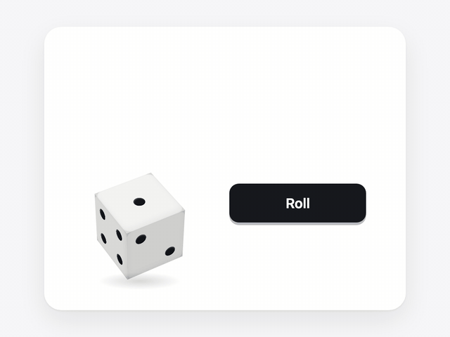

# react-roll-the-dice

[](https://www.npmjs.com/package/react-roll-the-dice)
[](https://bundlejs.com/?q=react-roll-the-dice)
[](https://www.npmjs.com/package/react-roll-the-dice)
[](./LICENSE)
[](https://yeonseong-lee.github.io/react-roll-the-dice/)

A 3D dice roller for React with **no runtime dependencies**. The die is a real CSS
cube — six positioned faces under `transform-style: preserve-3d` — and the throw is
plain CSS motion. No canvas, no WebGL, no physics engine, no animation library.

<p align="center">
  
</p>

<p align="center">
  <a href="https://yeonseong-lee.github.io/react-roll-the-dice/"><strong>Try the live demo →</strong></a>
</p>

```bash
npm install react-roll-the-dice
```

```tsx
import { useRef } from 'react'
import { Dice, type DiceHandle } from 'react-roll-the-dice'

function Board() {
  const dice = useRef<DiceHandle>(null)

  return (
    <>
      <Dice ref={dice} size={120} onRollEnd={(value) => console.log(value)} />
      <button onClick={() => dice.current?.roll()}>Roll</button>
    </>
  )
}
```

No stylesheet import required — the component renders its own `<style>` tag.

## Why it has no dependencies

`dependencies` is empty, and `react` is the only peer. Even `react-dom` is absent,
because nothing here reaches for a DOM renderer API. Installing this adds exactly
one package to your tree, and about **6 kB gzipped** to your bundle — component
and stylesheet together.

## API

### `<Dice />`

| Prop | Type | Default | |
|---|---|---|---|
| `size` | `number \| string` | `80` | Layout box the die is drawn to fit. Numbers mean pixels. |
| `defaultValue` | `DiceValue` | `1` | Face shown before the first roll. |
| `duration` | `number` | `1400` | Roll length in ms. |
| `faceColor` | `string` | `#fdfdfb` | Any CSS color. |
| `pipColor` | `string` | `#16181d` | Any CSS color. |
| `rollOnClick` | `boolean` | `false` | Makes the die clickable and keyboard-operable. |
| `injectStyles` | `boolean` | `true` | Set `false` to supply the CSS yourself. |
| `nonce` | `string` | — | Forwarded to the injected `<style>` tag for CSP. |
| `random` | `() => number` | — | Custom RNG in `[0, 1)`, for seeded or reproducible rolls. |
| `onRollStart` | `(value) => void` | — | Fires with the value the roll will land on. |
| `onRollEnd` | `(value) => void` | — | Fires when the die settles. |

Any other `div` prop (`className`, `style`, `id`, `aria-label`, …) is forwarded.

### Ref handle

```ts
interface DiceHandle {
  roll(): DiceValue        // starts a roll, returns the result synchronously
  set(value: DiceValue): void  // cancel any roll and jump to a face
  readonly value: DiceValue
  readonly rolling: boolean
}
```

`roll()` returns the result immediately, so you can update game state without
waiting for the animation. Use `onRollEnd` when you want to reveal it only once
the die has settled.

Rolling again mid-animation is fine — the die re-targets from wherever it is.
`onRollStart` fires once per call, but `onRollEnd` fires once per *landing*, so
a burst of rolls produces a single settle event carrying the final value.

`set(value)` cancels an active roll without calling `onRollEnd`, stops the throw,
and immediately shows the requested face. Changing `duration` or the motion
preference after a roll has finished does not emit another completion event.
With `duration={0}` or reduced motion enabled, completion is asynchronous, after
`onRollStart`, without the animated roll's fallback delay.

### `rollDiceValue(random?)`

The generator on its own, if you want to roll without rendering. Uses
`crypto.getRandomValues` with rejection sampling — folding the leftover byte
values in with a plain modulo would make 1–4 come up slightly more often than
5–6, which is a loaded die.

For a small, React-free runtime entry, including use in a Server Component:

```ts
import { rollDiceValue, type DiceValue } from 'react-roll-the-dice/random'

const value: DiceValue = rollDiceValue()
```

This subpath supports both ESM and CommonJS and has no `"use client"` boundary.
The existing root export remains available for compatibility.

## Styling

Every visual is a CSS custom property on the `.rtd-scene` element, so you can
theme it without touching props:

```css
.rtd-scene {
  --rtd-face-color: #1e2130;
  --rtd-pip-color: #ffd9a0;
  --rtd-view-x: -44deg;   /* camera pitch */
  --rtd-view-y: 30deg;    /* camera yaw   */
  --rtd-fit: 0.58;        /* die scaled to fit that box     */
  --rtd-ease: cubic-bezier(0.18, 0.9, 0.24, 1.04);
}
```

Flattening `--rtd-view-x` toward `0deg` swings the camera round to eye level. The
result still sits on the top face, so a shallow pitch makes it harder to read,
not easier.

### Sharing one stylesheet

React 17 and 18 render an inline stylesheet for each auto-styled die. To share
one stylesheet across a board on any supported React version, render
`DiceStyles` once and turn off injection on the dice:

```tsx
import { Dice, DiceStyles } from 'react-roll-the-dice'

function Board() {
  return (
    <>
      <DiceStyles />
      <Dice injectStyles={false} />
      <Dice injectStyles={false} defaultValue={6} />
    </>
  )
}
```

Alternatively, import `react-roll-the-dice/styles.css` once and use
`injectStyles={false}` on every die. Both approaches include styles in the
initial page output when configured for SSR. `injectStyles={false}` suppresses
the style element; it does not remove the embedded CSS from the JavaScript bundle.

### Content Security Policy

The inline `<style>` needs `style-src`. Either pass a nonce:

```tsx
<Dice nonce={cspNonce} />
```

With a nonce, the component renders a regular inline style so the attribute is
preserved during SSR without configuring the server renderer. For several dice,
use `<DiceStyles nonce={cspNonce} />` once with `injectStyles={false}` on every
die. Keep the nonce consistent between server rendering and hydration.

Or turn injection off and import the stylesheet yourself:

```tsx
import 'react-roll-the-dice/styles.css'

<Dice injectStyles={false} />
```

These options control stylesheet elements. Dice still uses inline `style`
attributes for size, rotation and face placement, so it is not compatible with
a policy that blocks all style attributes, such as `style-src-attr 'none'`.

## Notes

- **Server rendering.** The stylesheet is part of the rendered output, so there
  is no flash of unstyled dice. The component is marked `"use client"` and works
  as a client component in the Next.js App Router.
- **React 19.** Without a nonce, the `<style>` tag carries `href` and `precedence`,
  so React hoists and de-duplicates it — many dice on a page produce one tag in `<head>`.
  For React 17/18 or nonce-based styles, share `DiceStyles` or import the CSS once.
- **Reduced motion.** Under `prefers-reduced-motion: reduce` the tumble is
  skipped and the result appears immediately. `onRollEnd` still fires asynchronously.
- **The result is the top face.** The camera looks down at the die, so you read
  it the way you read a die on a table — no need to work out which of the
  visible faces is the one that counts.
- **Fair and physical.** Opposite faces sum to 7 and the die is right-handed, the
  Western convention. Each throw picks its own spin counts and landing angle, so
  no two rolls trace the same arc.

## Development

`npm test` builds the package and runs the DOM, SSR/hydration, lifecycle and
consumer bundle tests. `npm run typecheck` and `npm run lint:pkg` check the source
types and published package entrypoints. Test dependencies are development-only;
the package still has no runtime dependencies.

To run the DOM and SSR tests against another installed React/ReactDOM pair, set
`RTD_REACT_DIR` to that installation's directory (containing `node_modules`), then
run `node --test tests/dice.test.mjs tests/styles.test.mjs` after building.

## License

MIT
